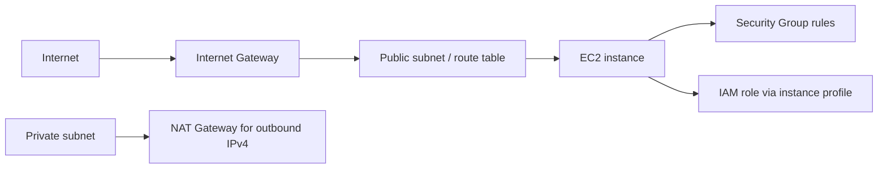

# Amazon Web Services (AWS)

## 1. Introduction

AWS is a cloud platform offering on-demand compute, networking, storage, identity, and managed services. This guide connects the AWS topics in this learning repository; it does not describe a deployed or existing AWS project.

## 2. Core concepts

An **AWS Region** contains multiple Availability Zones. An account is an administrative and billing boundary. EC2 instances run inside a VPC, receive network interfaces and addresses, and are controlled by both network rules and IAM authorization:



This is a conceptual example, not a complete or deployed architecture. A public subnet route alone does not make an instance reachable; addressing and security controls must also allow the traffic.

## 3. How it works

VPC route tables determine where packets are sent. Security Groups act as stateful virtual firewalls attached to network interfaces. IAM policies decide which AWS API actions an identity may perform; they do not open network ports. Domain DNS records resolve names to endpoints but do not grant authorization.

## 4. Commands and examples

Read-only inspection examples (AWS CLI credentials and permissions are still required):

```sh
aws sts get-caller-identity
aws ec2 describe-instances --region REGION
aws ec2 describe-vpcs --region REGION
aws ec2 describe-security-groups --region REGION
```

Replace `REGION` with an authorized region. These commands inspect current account resources; do not share their output if it contains sensitive account details.

## 5. Configuration examples

Example AWS CLI profile using IAM Identity Center (AWS CLI v2). Replace placeholders with values supplied by your administrator; this configuration contains no long-lived access key:

```ini
[sso-session lab]
sso_start_url = https://example.awsapps.com/start
sso_region = us-east-1
sso_registration_scopes = sso:account:access

[profile lab-readonly]
sso_session = lab
sso_account_id = REPLACE_WITH_AUTHORIZED_ACCOUNT_ID
sso_role_name = ReadOnlyAccess
region = us-east-1
output = json
```

Sign in with `aws sso login --profile lab-readonly`. Use only an assigned role/profile; the role name and SSO start URL are administrator-specific. For EC2 launch planning, VPC routing, Security Group rules, IAM policies/roles, and DNS record examples, see the linked guides. Do not paste account IDs, key material, or credentials into tracked files.

## 6. Hands-on exercises

**Prerequisites:** AWS account authorization, region selection, budget awareness, and a disposable lab plan. **Expected outcome:** understand how a private EC2 instance gets only the connectivity it needs.

1. Draw a two-subnet VPC design and mark routes, gateways, Security Groups, and IAM role separately.
2. Inspect existing resources using the read-only commands above.
3. If proceeding with an authorized account, follow AWS console documentation to create a small, tagged lab only after reviewing charges and access boundaries. This repository does not execute resource changes.
4. Confirm cleanup steps before creating anything; terminate the instance and remove only resources created for the lab.

## 7. Real-world use cases

Hosting compute workloads, segmenting application tiers, providing managed identity to services, and resolving service names to cloud endpoints.

## 8. Best practices

- Use least-privilege IAM roles, private subnets for workloads that do not need inbound internet access, and restricted Security Groups.
- Enable MFA, CloudTrail, budgets/alerts, and resource tagging; select supported instance types and right-size workloads.
- Prefer temporary credentials, encryption, patching, backups, and documented ownership/cleanup.
- Review data transfer, NAT Gateway, public IPv4, storage, and snapshot charges, not only instance-hour cost.
- Keep IaC plans, state, and credentials protected.

## 9. Common errors and troubleshooting

Check account/region, IAM authorization, resource state, subnet route table, public IP assignment, Network ACLs, Security Groups, DNS, and host firewall separately. See the linked [EC2](./ec2/README.md), [VPC](./vpc/README.md), [Security Groups](./security-groups/README.md), [IAM](./iam/README.md), and [DNS](./domains-dns/README.md) guides.

## 10. Interview questions

1. **What is a Region?** A geographic AWS area containing isolated Availability Zones.
2. **What makes a subnet public?** Its route table has a route to an Internet Gateway; a host also needs suitable addressing and security rules to communicate directly.
3. **Security Group vs. IAM policy?** A Security Group controls network traffic; IAM controls AWS API actions on resources.
4. **Why use an EC2 role?** It supplies temporary credentials to applications without distributing long-lived access keys.
5. **What costs can persist after stopping an instance?** EBS volumes, snapshots, Elastic IP/public IPv4 charges, NAT Gateways, and other attached services may continue to incur charges.

## 11. Further learning

- [AWS documentation](https://docs.aws.amazon.com/)
- [AWS Well-Architected Framework](https://docs.aws.amazon.com/wellarchitected/latest/framework/welcome.html)
- [AWS Pricing Calculator](https://calculator.aws/)

## 12. Progress checklist

- [ ] Explain EC2, VPC, subnet routes, Security Groups, and IAM roles
- [ ] Distinguish network reachability from API authorization
- [ ] Inspect resources and verify account/region before changes
- [ ] Estimate cost and document ownership and cleanup for a lab
