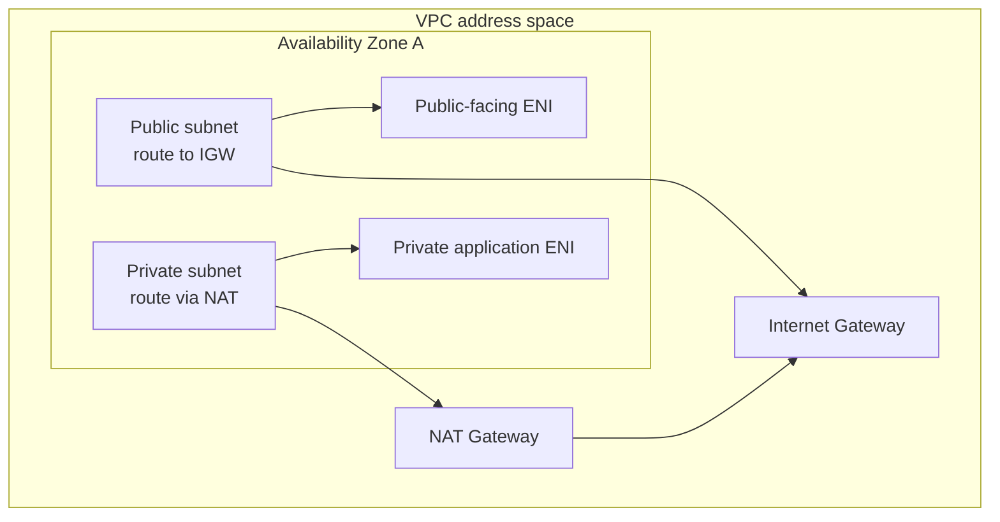

# Amazon VPC and Networking

## 1. Introduction

Amazon Virtual Private Cloud (VPC) is a logically isolated network in an AWS Region. It gives engineers control over address ranges, subnets, routing, and connectivity for resources such as EC2 instances.

## 2. Core concepts

- **CIDR:** address range, for example `10.20.0.0/16`; smaller prefix length means a larger range.
- **Subnet:** a range in one Availability Zone. AWS reserves addresses in each IPv4 subnet.
- **Route table:** destinations mapped to targets such as local VPC routing, Internet Gateway, NAT Gateway, or VPN.
- **Internet Gateway (IGW):** VPC attachment supporting internet routing for public resources.
- **NAT Gateway:** managed outbound path commonly used by private IPv4 subnets; it does not provide unsolicited inbound connections and incurs charges.
- **Network interface (ENI):** virtual network adapter associated with private IPs and Security Groups.
- VPC routes and Network ACLs complement **stateful Security Groups**; they serve different functions.

## 3. How it works

An EC2 network interface receives a private address from its subnet. The subnet's route table chooses the next hop for each destination. A public subnet commonly has a default route to an IGW, while a private subnet may route outbound IPv4 through NAT. An internet-routable path, appropriate public addressing, and permissive security controls are all required for direct inbound connectivity.



This diagram is conceptual. Production high availability and egress design require additional decisions.

## 4. Commands and examples

Read-only AWS CLI inspection:

```sh
aws ec2 describe-vpcs --region REGION
aws ec2 describe-subnets --region REGION
aws ec2 describe-route-tables --region REGION
aws ec2 describe-network-interfaces --region REGION
```

Linux diagnostics for a host you administer:

```sh
ip address
ip route
ss -lnt
```

## 5. Configuration examples

A planning example (not an applied configuration):

| Tier | Example CIDR | Route intent |
|---|---|---|
| VPC | `10.20.0.0/16` | Local VPC route |
| Public subnet (AZ A) | `10.20.1.0/24` | Default IPv4 route to IGW |
| Private subnet (AZ A) | `10.20.11.0/24` | Optional outbound route through NAT |

Choose non-overlapping ranges that fit organizational and connected-network plans. Actual subnet CIDRs must fit inside the VPC range.

## 6. Hands-on exercises

**Prerequisites:** AWS networking fundamentals and permission to inspect an account; no resources need to be created. **Expected outcome:** explain the route path from an instance to an external destination.

1. Draw a VPC with separate public and private subnets across two AZs.
2. Mark route tables, IGW, optional NAT Gateway, ENIs, and Security Groups.
3. Use the read-only commands to inspect an authorized existing VPC and compare its configuration with the drawing.
4. Estimate NAT and public IPv4 costs before considering a lab deployment. Do not create resources for this exercise.

## 7. Real-world use cases

Network segmentation, separating public load balancers from private application/data tiers, connecting cloud and on-premises networks, and controlling egress.

## 8. Best practices

- Plan non-overlapping CIDRs before connecting VPCs or corporate networks.
- Use multiple AZs for resilient designs; restrict route tables and egress intentionally.
- Prefer private subnets for internal workloads. NAT Gateways have hourly and data-processing charges.
- Monitor flow logs where appropriate; combine routes, Network ACLs, Security Groups, and host firewall policies.
- Document address ownership and avoid broad route propagation without review.

## 9. Common errors and troubleshooting

Check whether the CIDR overlaps, subnet/AZ selection, main and explicit route table associations, next-hop state, IGW attachment, NAT route and subnet, DNS settings, Network ACL return traffic, Security Group rules, and host routes/listeners. Use flow logs where enabled.

## 10. Interview questions

1. **What does `/16` mean in a CIDR?** The first 16 bits identify the network; IPv4 range size is `2^(32-16)` addresses.
2. **What makes a subnet public?** A route to an IGW; direct internet access also requires suitable addressing and security configuration.
3. **Does a NAT Gateway allow unsolicited inbound connections?** No, it is primarily for initiated outbound IPv4 connections and return traffic.
4. **What is an ENI?** A virtual network interface with addresses and attached network attributes.
5. **How are Security Groups different from route tables?** Routes select packet next hops; Security Groups filter allowed network flows statefully.

## 11. Further learning

- [Amazon VPC User Guide](https://docs.aws.amazon.com/vpc/latest/userguide/what-is-amazon-vpc.html)
- [VPC route tables](https://docs.aws.amazon.com/vpc/latest/userguide/VPC_Route_Tables.html)
- [VPC pricing](https://aws.amazon.com/vpc/pricing/)

## 12. Progress checklist

- [ ] Calculate and plan non-overlapping CIDR ranges
- [ ] Explain subnet associations, route tables, IGWs, and NAT Gateways
- [ ] Trace an EC2 network path using its ENI and subnet routes
- [ ] Diagnose reachability by separating routes and traffic filters
